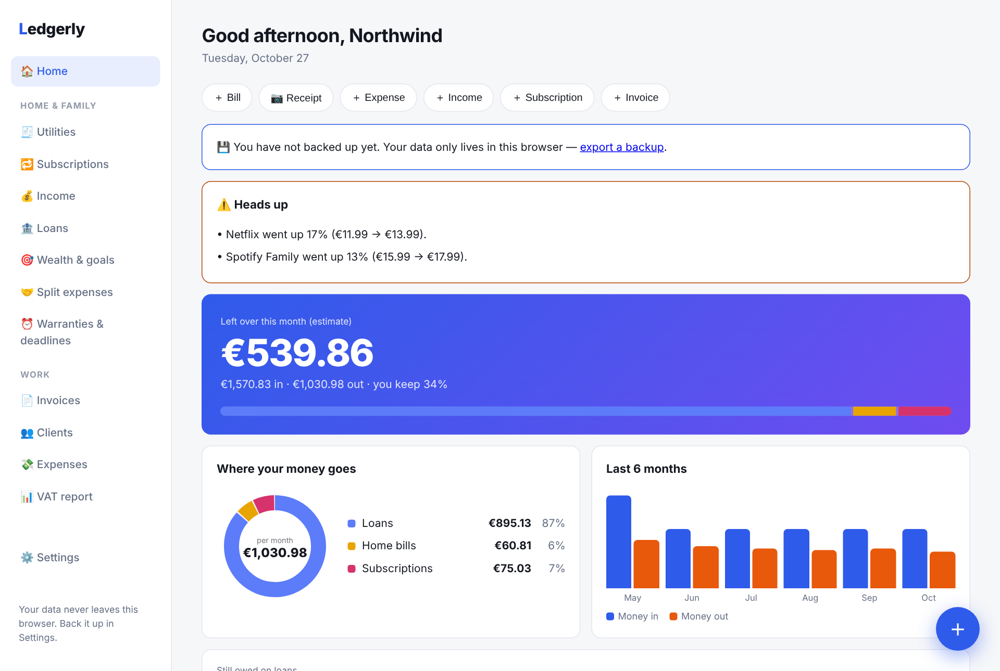
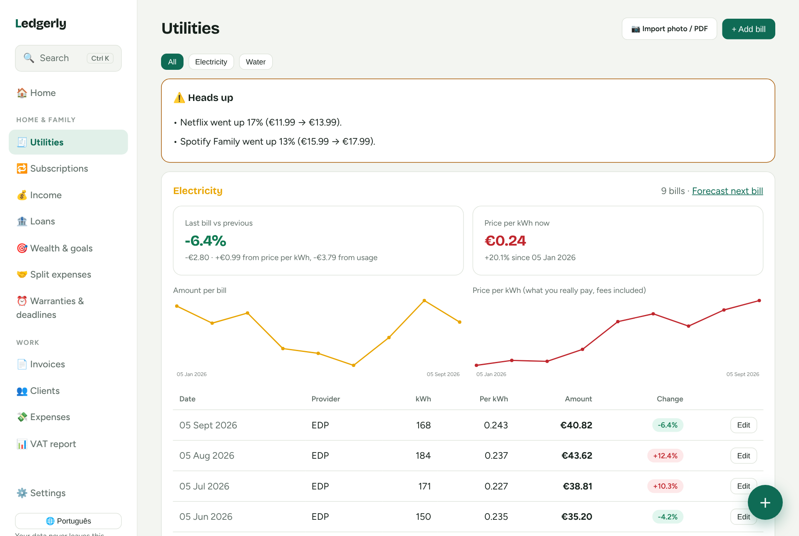
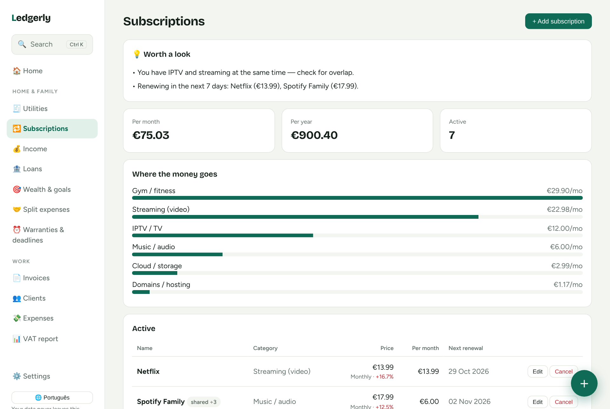
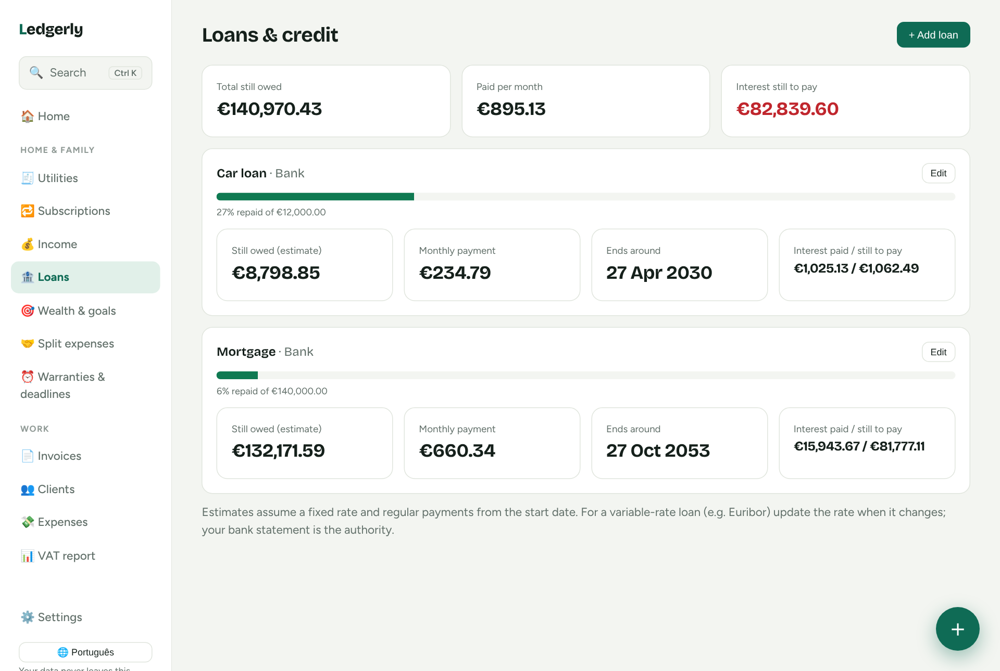
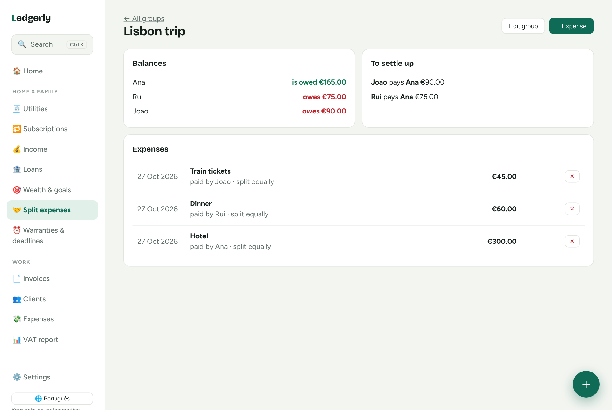
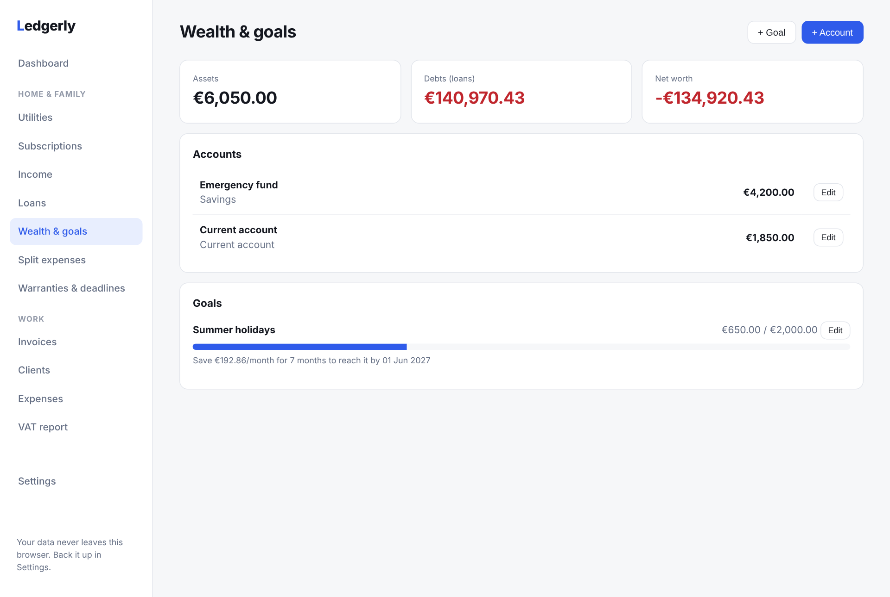
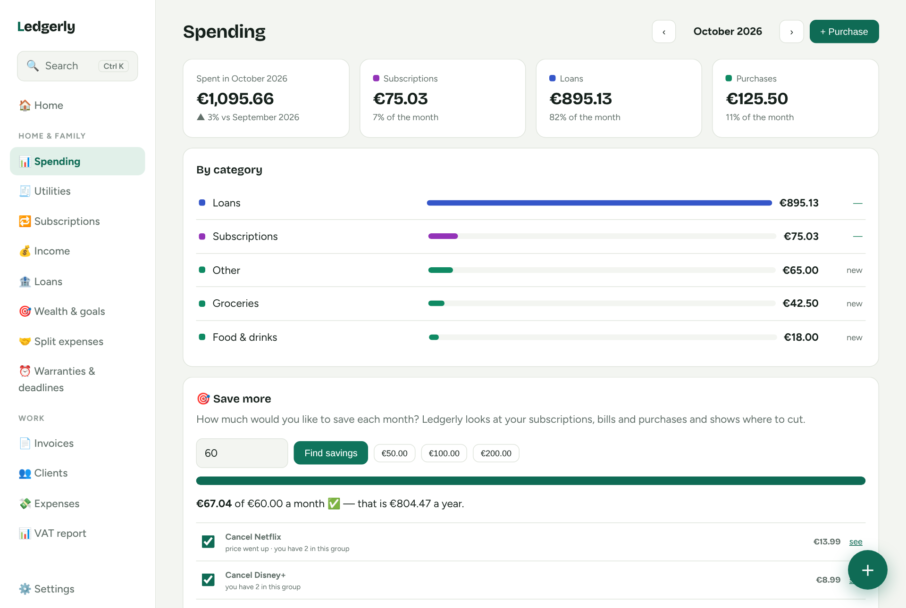
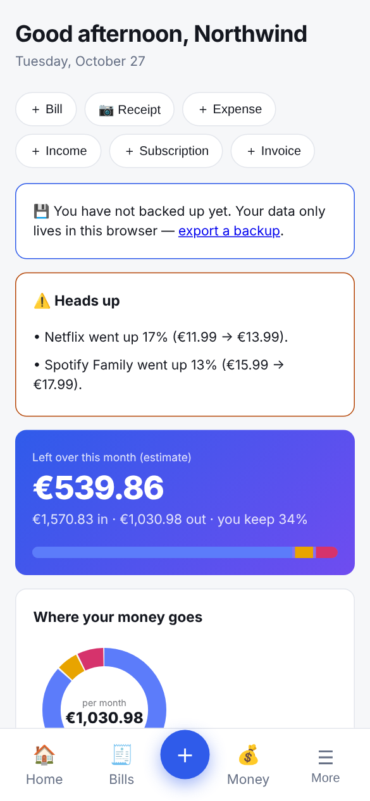

# Ledgerly

**Local-first money manager for your household and your small business** — invoices, bills, subscriptions, loans, savings goals and shared expenses, all in the browser. No account needed, no tracking, no server. Optional end-to-end encrypted family sync through *your own* Firebase project.

| Dashboard | Utilities (bills) |
|---|---|
|  |  |
| **Subscriptions** | **Loans & credit** |
|  |  |
| **Split expenses** | **Wealth & goals** |
|  |  |

*(Screenshots use fictional demo data — Settings → Load demo data.)*

## Features

**Home & family**
- **Utilities** — electricity, water, gas, internet, mobile, insurance, rent. Trend charts, change vs previous bill and vs a year ago, and every increase split into *price per unit* vs *usage*. Alerts for price jumps and possible water leaks, due-date reminders, next-bill forecast from a meter reading, optional per-person split, and an **offer comparison** (enter a tariff from the [ERSE simulator](https://www.erse.pt/simuladores/precos-de-energia/) to see the yearly saving).
- **Subscriptions** — streaming, IPTV, music, cloud, gaming, gym, domains… totals per month/year/category, renewal reminders, free-trial flags, price-rise alerts, shared plans, and a checklist of subscriptions people usually forget.
- **Income & Loans** — salary and other income; mortgage/car/personal loans with balance, interest paid vs still to pay and end date. A **month-at-a-glance** card shows what is left after everything.
- **Wealth & goals** — accounts, net worth over time, savings goals with the monthly amount needed.
- **Split expenses** — trips, flatmates, dinners: who owes whom, with the fewest payments to settle up.
- **Warranties & deadlines** — appliances with receipt attached; IRS, IMI, IUC, inspection, insurance renewals…

**Work**
- Invoices (auto numbering, per-line VAT, recurring, print → PDF), clients, expenses with budgets, quarterly **VAT report**.

**Capture without typing**
- Import a bill from a **PDF** (text) or **photo** (OCR); scan one or many **receipts**; import a **bank statement CSV** with automatic categories. Everything is previewed before it is saved.

**Privacy & safety**
- Data stays in your browser (localStorage + IndexedDB for attachments).
- **PIN lock**, automatic **backup to a folder** (Chrome/Edge — point it at a synced cloud folder), JSON export/import, monthly backup reminder.
- **Family space (optional)**: sync the household parts across devices. Data is AES-GCM encrypted in the browser with a key derived from your family code, so the database only ever stores ciphertext. The family code also remembers whether you chose household-only or everything.
- Installable **PWA**, works offline. Interface in **English and Português (pt-PT)**.

## Run it
Open `index.html`, or serve the folder (`python3 -m http.server`). Host it on GitHub Pages for install/offline and family sync (both need https).

## Family space setup (one time)
1. Firebase console → Authentication → enable **Anonymous** sign-in.
2. Realtime Database → Rules, add:
   ```json
   "households": { "$hid": { ".read": "auth != null", ".write": "auth != null" } }
   ```
3. In the app: Settings → Family space → paste the database URL and Web API key → *Create family space*. Share the generated code (privately) with your family; they choose *Join with a code*.

Choose how much to share when creating the space: **Household only** (bills, subscriptions, loans, accounts, goals, warranties, deadlines, split groups) or **Everything** for couples who manage money together — salaries, income, expenses and invoices included. You can change it later, and any single item can be marked **Private (only me)** so it never syncs. Income entries can say whose they are (e.g. "Ana"). Conflicts: the most recent edit of an item wins. Attachments are not synced.

## Honest limits
- The PIN is a screen lock, not encryption of local storage.
- Photo/PDF/OCR reading is best-effort — always check the preview. The OCR and PDF libraries load from a CDN on first use.
- Notifications appear while the app is open; real push needs a server.
- Not tax or legal advice; the VAT report is a summary for your accountant, not a filing.
- Loan figures assume a fixed rate; use your bank statement as the authority.

## Tests
No build step. Logic can be exercised in a browser with Playwright (see the commit history for the scenarios used).

## License
MIT

## Themes
Twenty-five ready-made looks in four groups — everyday (Caramel, Forest, Ocean…), anime-inspired (Neon Tokyo, Kawaii, Shōnen sunset, Spirit forest, Ramen night, Retro arcade), seasons & occasions (Christmas, Halloween, Sakura, Valentine, Autumn, Summer, New Year, Portugal) and fun & night (Cartoon, Midnight, Space) — or pick your own colours, light/dark mode and optional little decorations (snow, petals, bubbles, friendly animals).

## Spending & saving
See every month by category (bills, subscriptions, loans, purchases), compare with the previous month, add purchases in seconds (the category is remembered per shop) and tell Ledgerly how much you want to save — it suggests where to cut.

## On your phone & with Google
Installable on Android and iPhone, sign in with Google to keep phone and computer in sync (end-to-end encrypted). See [docs/MOBILE.md](docs/MOBILE.md).




